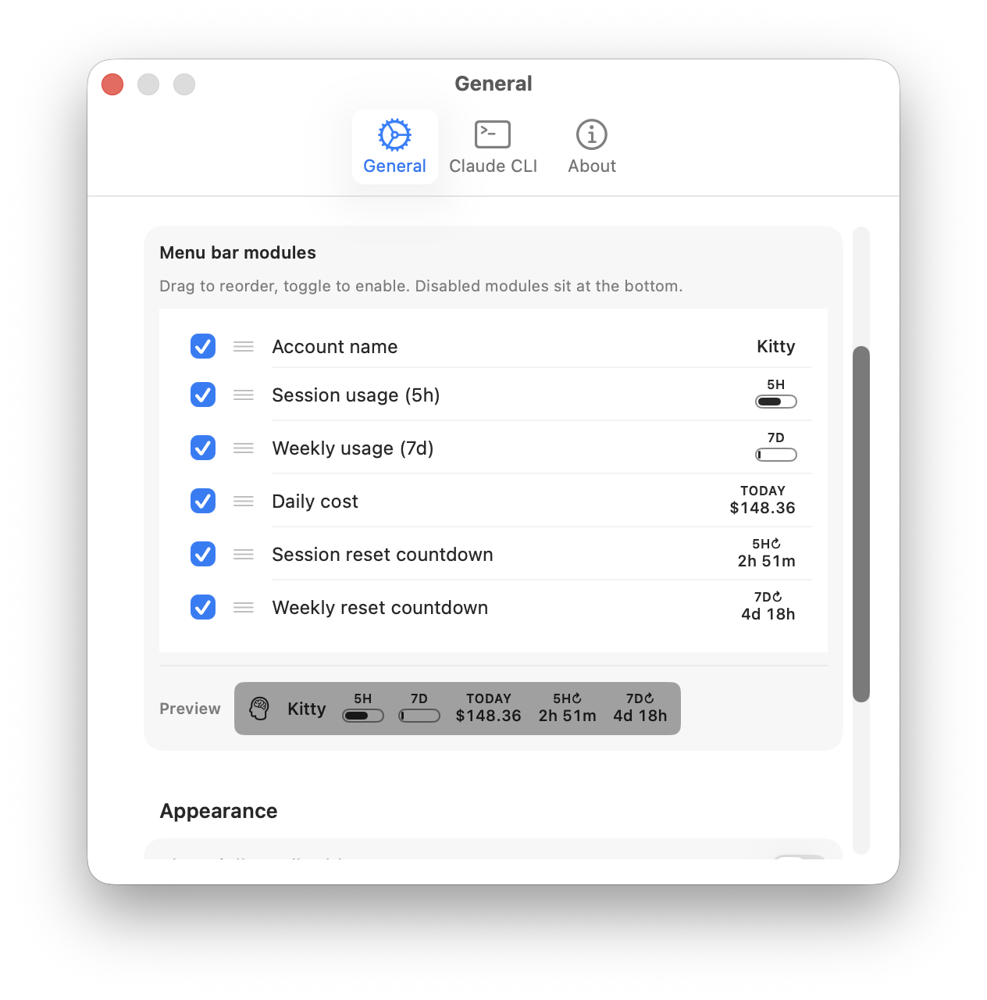

  
  
  
  
  
  

  
  
  
  
  
  

# CCSwitcher

CCSwitcher es una app ligera para macOS que vive solo en la barra de menús. Sirve para manejar varias cuentas de Claude Code y cambiar entre ellas **sin cortar tu forma de trabajar con varias cuentas**. El flujo nativo de `claude auth login` es destructivo: cada cambio borra las credenciales de la cuenta anterior y obliga a repetir todo el OAuth en el navegador. CCSwitcher guarda un respaldo de las credenciales de cada cuenta, al cambiar reemplaza de una sola vez la entrada del llavero y `~/.claude.json`, y todas las cuentas quedan listas para volver a ellas con un clic. Además, CCSwitcher muestra el uso de la API, renueva los tokens en segundo plano sin molestar y resuelve limitaciones comunes de las apps de barra de menús en macOS.

## Funciones

- **Cambio de cuenta sin interrupciones**: el `claude auth logout` nativo borra las credenciales de la cuenta actual, y para regresar a ella hay que repetir todo el OAuth. CCSwitcher guarda un respaldo aparte de cada cuenta (token del llavero + bloque `oauthAccount` de `~/.claude.json`) y al cambiar reemplaza los dos de una sola vez: las credenciales de todas las cuentas agregadas siguen intactas, se regresa con un clic y no se corta el trabajo. (Nota: una sesión de `claude` que ya está corriendo usará las credenciales nuevas en su siguiente llamada a la API. Así funciona Claude CLI; CCSwitcher no lo controla.)
- **Varias cuentas**: agrega cuentas de Claude Code y cambia entre ellas con un solo clic desde la barra de menús de macOS.
- **Panel de uso**: muestra en tiempo real tus límites de uso de la API de Claude (sesión de 5 horas y semanal) en el menú desplegable, junto con el costo equivalente en API de hoy y estadísticas de actividad (mensajes, minutos activos, líneas escritas y desglose por modelo).
- **Módulos configurables en la barra de menús**: arma tu propia lectura al estilo de iStats. Elige cualquier combinación de nombre de cuenta, uso de la sesión de 5 horas, uso semanal, costo de hoy y cuentas regresivas de reinicio de sesión y semanal. Cada uno se muestra como un módulo compacto de dos líneas (etiqueta arriba y valor abajo, con barras de progreso monocromas para el uso). En Ajustes puedes arrastrarlos para cambiar el orden y activarlos o desactivarlos, con vista previa en vivo.
- **Widgets de escritorio**: widgets nativos de macOS en tamaño pequeño, mediano y grande con el uso de las cuentas, los costos y las estadísticas de actividad. Incluye una versión con anillos para ver el uso de un vistazo.
- **Actualización automática dentro de la app**: funciona con [Sparkle 2.x](https://sparkle-project.org/). Las versiones nuevas se instalan solas y de una sola vez, sin arrastrar un DMG ni pasar por ventanas del Finder.
- **Modo oscuro**: soporte completo de modo claro y oscuro, con colores que siguen la apariencia del sistema.
- **Varios idiomas**: disponible en English, 简体中文 (chino), 日本語 (japonés), Deutsch (alemán), Français (francés) y español.
- **Interfaz que cuida tu privacidad**: oculta automáticamente parte de los correos y de los nombres de cuenta para que no se vean en capturas o grabaciones de pantalla.
- **Renovación del token sin hacer nada**: cuando vence el token OAuth de Claude, la app deja que la CLI oficial lo renueve en segundo plano.
- **Inicio de sesión sin terminal**: agrega cuentas nuevas sin abrir una terminal. La app llama a la CLI en silencio y se encarga del OAuth en el navegador.
- **Experiencia nativa**: una interfaz limpia en SwiftUI que se comporta como cualquier utilidad de barra de menús de macOS, con su ventana de ajustes completa.

## Capturas de pantalla

   
  <em>Tema claro</em>

   
  <em>Tema oscuro</em>

   
  <em>Widget de escritorio</em>

   
  <em>Módulos configurables de la barra de menús: cuenta, uso de sesión y semanal, costo diario y cuentas regresivas de reinicio</em>

   
  <em>Arrastra para cambiar el orden y activa o desactiva módulos, con vista previa en vivo</em>

## Demo

  <video src="https://github.com/user-attachments/assets/ca37eaae-e8d8-4557-995e-bc154442c833" width="864" autoplay loop muted playsinline />

## Funciones clave y arquitectura

CCSwitcher usa varias estrategias de arquitectura. Algunas son propias de cómo funciona la app y otras vienen de la comunidad de código abierto (sobre todo de [CodexBar](https://github.com/steipete/CodexBar)).

### 1. Cambio de cuenta sin interrupciones

La función principal: **CCSwitcher conserva las credenciales de todas las cuentas agregadas, así que cambiar de cuenta nunca corta tu trabajo con varias cuentas.**

La CLI nativa no tiene un comando limpio para "cambiar de cuenta": `claude auth logout && claude auth login` borra la entrada del llavero de la cuenta actual y abre de nuevo todo el OAuth en el navegador; regresar a la cuenta anterior significa otro OAuth completo. CCSwitcher lo hace de otra forma:

- Cada cuenta que ya agregaste queda en el respaldo propio de CCSwitcher (`~/.ccswitcher/backups.json`), con el JSON del token OAuth y el bloque `oauthAccount` que le corresponde en `~/.claude.json`.
- Cuando eliges otra cuenta, CCSwitcher, de una sola vez, (a) escribe el token de esa cuenta en la entrada `Claude Code-credentials` del llavero de macOS y (b) reemplaza el bloque `oauthAccount` en `~/.claude.json`. Las dos escrituras usan las API de archivos de Foundation, sin los efectos destructivos de cerrar e iniciar sesión.
- Resultado: las credenciales de todas las cuentas agregadas siguen intactas en el respaldo, listas para regresar con un clic sin repetir el OAuth. Las llamadas nuevas a `claude` usan de inmediato la cuenta elegida.

**Sobre las sesiones que ya están corriendo**: CCSwitcher solo cambia las credenciales en disco; no se comunica con ningún proceso de `claude` abierto. Si cambias de cuenta a mitad de una sesión, la siguiente llamada a la API de esa sesión usará las credenciales nuevas. Así funciona Claude CLI (vuelve a leer el llavero en cada llamada); CCSwitcher no lo controla. Si necesitas que una sesión termine con su cuenta original, ciérrala antes de cambiar.

### 2. Inicio de sesión sin terminal (`Process` + `Pipe` nativos)

A diferencia de las herramientas que arman pseudoterminales (PTY) complejos para manejar el inicio de sesión de la CLI, CCSwitcher usa un enfoque mínimo para agregar cuentas:

- Usamos `Process` nativo y la redirección estándar con `Pipe()`.
- Cuando `claude auth login` corre en silencio en segundo plano, Claude CLI detecta que no es un entorno interactivo y abre el navegador predeterminado para hacer el OAuth.
- Cuando el usuario autoriza en el navegador, el proceso de la CLI termina con código de salida 0. Entonces CCSwitcher toma las credenciales nuevas del llavero y el bloque `oauthAccount`, sin que el usuario abra nunca una terminal.

### 3. Renovación del token delegada (un camino distinto al de CodexBar)

Los tokens de acceso OAuth de Claude duran poco (unas 8 horas) y el endpoint para renovarlos está protegido por las firmas internas de cliente de Claude CLI y por Cloudflare. Las apps de terceros que quieren renovarlos solas tienen dos caminos, y aquí CCSwitcher y [CodexBar](https://github.com/steipete/CodexBar) hacen cosas **muy distintas**:

- **Lo que hace CodexBar**: envía un POST directo al endpoint OAuth de renovación de Anthropic, que no es público (`https://platform.claude.com/v1/oauth/token`), con un `client_id` fijo en el código (`9d1c250a-…`, sacado del binario de Claude CLI) y el `refresh_token` del llavero; luego lee la respuesta y guarda los tokens nuevos por su cuenta. A favor: no necesita un subproceso y es rápido. En contra: Anthropic **no** documenta oficialmente ese endpoint ni ese client_id; si cambian el client_id o el endpoint, o agregan verificación del cliente, la renovación deja de funcionar sin avisar hasta que salga una actualización de la app.
- **Lo que hace CCSwitcher**: espera la respuesta `HTTP 401: token_expired` de la API de uso de Anthropic; cuando llega, corre en silencio `claude auth status`, un comando de solo lectura, para que la CLI oficial use **su propia lógica de renovación, mantenida por Anthropic**, obtenga un token nuevo y lo guarde en el llavero. CCSwitcher vuelve a leer el llavero y repite la consulta de uso.

Elegimos a propósito la segunda opción. Cuesta un subproceso pequeño en cada renovación, pero tiene dos ventajas reales:

1. **Más segura**: la renovación pasa por el mecanismo de autenticación de la propia CLI de Anthropic. CCSwitcher nunca guarda ni reutiliza su `client_id` interno. Si Anthropic agrega verificaciones más estrictas del lado del cliente (por ejemplo, certificación del binario), las heredamos solas sin actualizar la app.
2. **Lista para el futuro**: el endpoint, el client_id y el formato del token no nos toca mantenerlos. Cada actualización de la CLI trae la lógica de renovación nueva.

Para el usuario el resultado es igual que en CodexBar: sin cortes y sin hacer nada. La diferencia es **quién se encarga de seguir los cambios de la parte privada de OAuth de Anthropic**: CodexBar lo asume (más rápido, más riesgoso); CCSwitcher se lo deja a la CLI oficial (un subproceso pequeño, más seguro).

### 4. Caché local de lectura de JSONL (rendimiento)

Los resúmenes de costo y las estadísticas de actividad de hoy se calculan con los archivos JSONL de cada sesión de Claude Code en `~/.claude/projects/`. Si usas mucho Claude Code, esa carpeta puede pesar cientos de megabytes repartidos en miles de archivos. Volver a leer todo cada 5 minutos dejaba el CPU al máximo aun sin usar la app ([#13](https://github.com/XueshiQiao/CCSwitcher/issues/13)).

- CCSwitcher guarda un caché persistente por archivo en `~/Library/Application Support/CCSwitcher/session-parse-cache.json`, según la fecha de modificación (mtime) de cada archivo.
- En cada actualización se saltan por completo los archivos cuyo mtime no cambió: el caché ya tiene sus totales y la suma se hace en memoria.
- Solo se vuelven a leer los archivos que están cambiando (casi siempre solo tu sesión actual de Claude Code). Las actualizaciones normales bajan de unos 5 segundos con el CPU al máximo a menos de 100 ms.

### 5. Lectura del llavero con la CLI `security`

Leer el llavero de macOS con `Security.framework` nativo (`SecItemCopyMatching`) desde una app de barra de menús en segundo plano a veces muestra una ventana del sistema que bloquea: "CCSwitcher quiere acceder a tu llavero". Para evitarlo, CCSwitcher usa la estrategia de CodexBar:

- Corremos la herramienta que trae el sistema: `/usr/bin/security find-generic-password -s "Claude Code-credentials" -w`.
- Cuando macOS pregunta *la primera vez*, el usuario hace clic en **"Permitir siempre"**. Como la solicitud viene de un binario del sistema y no de nuestra app firmada, el permiso queda guardado para siempre.
- Las consultas siguientes en segundo plano no muestran nada.

**Sobre las entradas de respaldo propias de CCSwitcher en el llavero**: el almacén de respaldos por cuenta (`me.xueshi.ccswitcher.backups`) es una entrada del llavero que crea y maneja CCSwitcher, así que no hay ventana de otro proveedor que evitar. La leemos y escribimos con `Security.framework` nativo (`SecItemCopyMatching` / `SecItemAdd`), sin subproceso ni ventana. En resumen: **el subproceso `/usr/bin/security` se usa solo para leer la entrada de Claude Code, que es de otro proveedor; todo lo demás usa la API nativa más directa.**

### 6. App Group con el Team ID al inicio (sin la ventana "acceder a datos de otras apps")

macOS 15 Sequoia cambió sin avisar las reglas de los contenedores de App Group: cualquier app que no viene de la Mac App Store ni de TestFlight y cuyo ID de App Group NO empieza con el Team ID del desarrollador muestra una ventana de TCC de "Gestión de apps" en cada arranque (y otra vez después de cada actualización automática que cambia el cdhash del binario). Para evitarlo, el App Group de CCSwitcher se identifica como `584KQTRF3B.me.xueshi.ccswitcher`, con el Team ID al inicio: macOS lo autoriza solo en las apps firmadas con Developer ID, sin perfil de aprovisionamiento. La investigación completa está en [#14](https://github.com/XueshiQiao/CCSwitcher/issues/14).

### 7. Ventana `Settings` de SwiftUI viva en una app `LSUIElement`

Como CCSwitcher es una app que vive solo en la barra de menús (`LSUIElement = true`), SwiftUI se niega a mostrar la ventana nativa `Settings { … }`. Es una rareza conocida de macOS: SwiftUI asume que la app no tiene una escena activa a la cual agregar los ajustes. CCSwitcher usa el truco de **mantener viva la escena** de CodexBar:

- Al abrir, la app crea un `WindowGroup("CCSwitcherKeepalive") { HiddenWindowView() }`.
- `HiddenWindowView` toma su `NSWindow` y la convierte en una ventana de 1×1 píxel, totalmente transparente, que deja pasar los clics y está fuera de la pantalla en `(-5000, -5000)`.
- Como esa "ventana fantasma" existe, SwiftUI cree que la app tiene una escena activa. Cuando el usuario hace clic en el engranaje, enviamos una `Notification` que la ventana fantasma recibe para llamar a `@Environment(\.openSettings)`, y así se abre una ventana de ajustes nativa que funciona bien.
