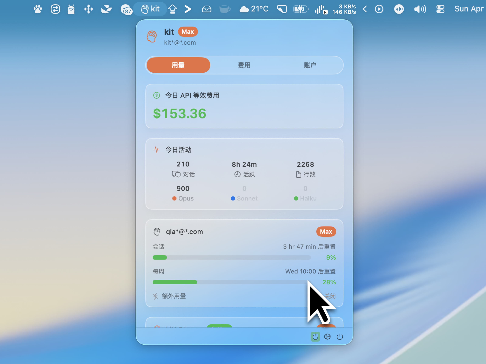
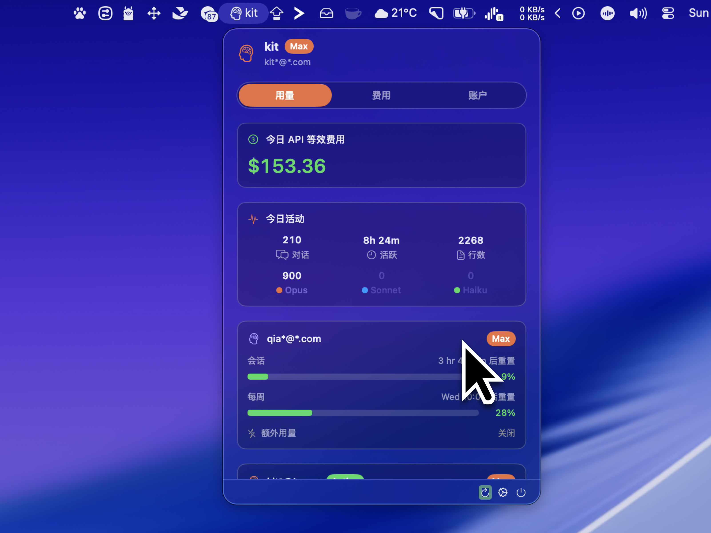

  
  
  
  
  
  

# CCSwitcher

CCSwitcher 是一款轻量级的纯 macOS 菜单栏应用程序，旨在帮助开发者管理和切换多个 Claude Code 账户**而不中断你的多账户工作流**。原生 `claude auth login` 每次切换都要走完整的浏览器 OAuth、丢掉前一个账户的凭据；CCSwitcher 为每个已添加的账户单独备份凭据，切换时原子性地替换钥匙串和 `~/.claude.json`，所有账户的凭据始终保留，随时一键切回。CCSwitcher 还能监控 API 使用情况，优雅地处理后台 token 刷新，并绕开 macOS 菜单栏应用的常见限制。

## 功能特性

- **不中断的账户切换**：原生 `claude auth logout` 每次切换都要走一次完整 OAuth，前一个账户的凭据会被清除。CCSwitcher 为每个账户保留独立的备份（钥匙串 token + `~/.claude.json` 的 `oauthAccount` 块），切换时原子性地替换两者——所有已添加账户的凭据都不会丢失，随时一键切回，不打断你的多账户工作流。（注：进行中的 `claude` 会话会在下一次 API 调用时使用新切换的凭据，这是 Claude CLI 自身的行为。）
- **多账户管理**：在 macOS 菜单栏中一键添加和切换不同的 Claude Code 账户。
- **用量仪表盘**：直接在菜单栏下拉菜单中实时监控 Claude API 使用限额（5 小时会话窗口和每周窗口），并展示当日的 API 等价费用与活动统计（轮次、活跃分钟数、写入行数、模型分布）。
- **桌面小组件**：原生 macOS 桌面小组件，支持小、中、大三种尺寸，展示账户用量、费用和活动统计。还包含环形变体，方便一目了然地监控使用情况。
- **应用内自动更新**：基于 [Sparkle 2.x](https://sparkle-project.org/)。新版本静默原子安装——无需拖拽 DMG，无需 Finder 对话框。
- **深色模式**：完整支持亮色和深色模式，自适应颜色随系统外观自动切换。
- **国际化**：支持 English、简体中文、日本語、Deutsch、Français 和 Español 六种语言。
- **隐私保护界面**：在截图或屏幕录制中自动模糊处理邮箱地址和账户名称，保护您的身份信息。
- **零交互 Token 刷新**：通过将刷新过程委托给后台运行的官方 CLI，智能处理 Claude 的 OAuth token 过期问题。
- **无缝登录流程**：无需打开终端即可添加新账户。应用在后台静默调用 CLI 并为您处理浏览器 OAuth 流程。
- **系统原生体验**：简洁的原生 SwiftUI 界面，表现完全如同一流的 macOS 菜单栏工具，配备功能完整的设置窗口。

## 截图

   
  <em>浅色主题</em>

   
  <em>深色主题</em>

   
  <em>桌面小组件</em>

## 演示

  <video src="https://github.com/user-attachments/assets/ca37eaae-e8d8-4557-995e-bc154442c833" width="864" autoplay loop muted playsinline />

## 核心特性与架构

CCSwitcher 采用了多种特定的架构策略，其中一些是为其独特运行方式量身定制的，另一些则借鉴了开源社区的灵感（特别是 [CodexBar](https://github.com/steipete/CodexBar)）。

### 1. 不中断的账户切换

CCSwitcher 的标志性特性：**保留每个已添加账户的完整凭据，让切换账户不打断你的多账户工作流。**

原生 CLI 没有干净的「切换账户」命令——`claude auth logout && claude auth login` 会清除当前账户的钥匙串条目并触发一轮完整的浏览器 OAuth，想切回前一个账户就得再次完整登录。CCSwitcher 走的是另一条路：

- 每个之前添加过的账户都存储在 CCSwitcher 自己的备份文件（`~/.ccswitcher/backups.json`）中，包含 OAuth token JSON 以及 `~/.claude.json` 中对应的 `oauthAccount` 块。
- 当用户选择切换账户时，CCSwitcher 会原子性地完成两件事：(a) 把目标账户的 token 写入 macOS 钥匙串条目 `Claude Code-credentials`，(b) 覆盖 `~/.claude.json` 中的 `oauthAccount` 块。两次写入都通过 Foundation 文件 API 完成，没有 logout/login 的破坏性副作用。
- 结果：所有已添加账户的凭据都保留在备份中，随时一键切回，无需重新走 OAuth；新启动的 `claude` 会话立即使用新选中的账户。

**关于进行中的会话**：CCSwitcher 只负责原子性地替换磁盘上的凭据，并不与任何正在运行的 `claude` 进程通信。如果你在一个 `claude` 交互会话中途切换账户，该会话的下一次 API 调用就会使用新切换的凭据——这是 Claude CLI 自身的行为（它每次调用都会重新读取钥匙串），不是 CCSwitcher 控制的。如果你希望正在进行的会话用完原账户再切换，先把那个会话结束掉。

### 2. 终端无感的登录流程（原生 `Process` + `Pipe`）

与其他构建复杂伪终端（PTY）来处理 CLI 登录状态的工具不同，CCSwitcher 使用极简方式添加新账户：

- 我们依赖原生 `Process` 和标准 `Pipe()` 重定向。
- 当 `claude auth login` 在后台静默执行时，Claude CLI 能够智能检测到非交互式环境，并自动启动系统默认浏览器来处理 OAuth 流程。
- 用户在浏览器中完成授权后，后台 CLI 进程以成功退出码（0）终止。CCSwitcher 随即捕获新生成的钥匙串凭证和 `oauthAccount` 块——全程用户无需打开终端。

### 3. 委托式 Token 刷新（与 CodexBar 走不同的路）

Claude 的 OAuth access token 生命周期较短（通常约 8 小时），刷新端点受 Claude CLI 内部客户端签名和 Cloudflare 保护。第三方应用想做自动刷新有两条路，CCSwitcher 与 [CodexBar](https://github.com/steipete/CodexBar) 在这里**有本质区别**：

- **CodexBar 的做法**：直接 POST 到 Anthropic 的非公开 OAuth 刷新端点（`https://platform.claude.com/v1/oauth/token`），把硬编码的 `client_id`（`9d1c250a-…`，从 Claude CLI 二进制中提取）和钥匙串里的 `refresh_token` 一起发出去，自己解析新 token 后写回。优点是不依赖任何子进程，速度快；缺点是这是 Anthropic 未对外公开的接口和未公开的 client_id——一旦 Anthropic 改端点、旋转 client_id 或加上 attestation 检查，刷新就会无声失败，必须等下一版应用更新。
- **CCSwitcher 的做法**：监听 Anthropic Usage API 的 `HTTP 401: token_expired`；捕获到 401 时启动一个静默后台 `claude auth status`——只读命令——让官方 Claude CLI 用它**自己内部的、官方维护的**刷新逻辑去拿新 token、写回钥匙串。CCSwitcher 随后重新读取钥匙串并重试用量请求。

我们选择后者，是个有意识的权衡：用每次刷新启动一次子进程的小开销，换两样东西——

1. **安全性更高**：刷新走 Anthropic 官方 CLI 自身的认证机制，不需要 CCSwitcher 持有或重发它们的 client_id；如果它们将来加上更严格的客户端校验（比如二进制 attestation），我们自动跟随，无需更新。
2. **长期稳定**：端点、client_id、token 格式怎么变都不归我们维护——CLI 升级会自动带来新的刷新逻辑。

用户感知与 CodexBar 是一样的：无缝、零交互。差异在「谁负责对接 Anthropic 的私有 OAuth 接口」——CodexBar 选择自己对接（性能更好但风险更大），CCSwitcher 选择委托给官方 CLI（开销略大但更安全）。

### 4. 本地 JSONL 解析缓存（性能）

费用汇总和当日活动统计都是从 `~/.claude/projects/` 下每个会话的 JSONL 文件计算出来的。重度用户的该目录可能有数千个文件、共数百兆。最初每 5 分钟重新解析整棵目录树会在空闲时把 CPU 跑满（[#13](https://github.com/XueshiQiao/CCSwitcher/issues/13)）。

- CCSwitcher 在 `~/Library/Application Support/CCSwitcher/session-parse-cache.json` 维护一份按文件 mtime 索引的持久化逐文件解析缓存。
- 每次刷新时，mtime 未变化的文件被完全跳过——缓存中保存了它们之前的解析聚合结果，内存里求和即可。
- 只有正在被修改的文件（通常就是你当前的 Claude Code 会话）会被重新解析。稳态刷新从约 5 秒的 CPU 满载降到 100ms 以下。

### 5. Security-CLI 钥匙串读取器

通过原生 `Security.framework`（`SecItemCopyMatching`）从后台菜单栏应用读取 macOS 钥匙串，有时会弹出阻塞性的系统 UI 提示——"CCSwitcher 想要访问您的钥匙串"。为绕过这一点，CCSwitcher 采用了 CodexBar 的策略：

- 我们执行系统自带工具 `/usr/bin/security find-generic-password -s "Claude Code-credentials" -w`。
- 当 macOS *首次*提示用户时，用户点击**"始终允许"**。由于请求来自系统二进制文件而非我们签名的应用，授权会永久保留。
- 后续后台轮询完全静默。

**关于 CCSwitcher 自己的备份条目**：账户备份（`me.xueshi.ccswitcher.backups`）是 CCSwitcher 自己创建的 keychain 条目，不存在跨 vendor 访问问题，所以我们直接走原生 `Security.framework`（`SecItemCopyMatching` / `SecItemAdd`），不会触发任何提示。换句话说：**「走 `/usr/bin/security` 子进程」只用于绕开访问 Claude Code 那条系统条目时的跨 vendor 提示，其余 keychain 操作仍用最直接的原生 API。**

### 6. Team-ID 前缀的 App Group（避免"访问其他 App 数据"提示）

macOS 15 Sequoia 悄悄改了 App Group 容器的规则：任何非 Mac App Store、非 TestFlight 的应用，如果它的 App Group ID 不以开发者 Team ID 开头，每次启动都会触发 TCC「应用管理」提示（并在每次改变二进制 cdhash 的自动更新后再次触发）。为避免这一点，CCSwitcher 的 App Group 标识符是 `584KQTRF3B.me.xueshi.ccswitcher`——Team ID 前缀形式，对没有 provisioning profile 的 Developer-ID 签名应用，macOS 会自动授权。完整调查见 [#14](https://github.com/XueshiQiao/CCSwitcher/issues/14)。

### 7. SwiftUI `Settings` 窗口生命周期保活（适用于 `LSUIElement`）

由于 CCSwitcher 是纯菜单栏应用（`Info.plist` 中 `LSUIElement = true`），SwiftUI 拒绝呈现原生 `Settings { ... }` 窗口。这是一个已知的 macOS bug，SwiftUI 认为应用没有活跃的交互式场景来附加设置窗口。
- 我们实现了 CodexBar 的**生命周期保活**解决方案。
- 应用启动时，会创建一个 `WindowGroup("CCSwitcherKeepalive") { HiddenWindowView() }`。
- `HiddenWindowView` 拦截其底层 `NSWindow`，使其成为一个 1x1 像素、完全透明、可穿透点击的窗口，定位在屏幕外 `x: -5000, y: -5000` 的位置。
- 因为这个"幽灵窗口"的存在，SwiftUI 被欺骗为认为应用拥有活跃的场景。当用户点击齿轮图标时，我们发送一个 `Notification`，幽灵窗口捕获后触发 `@Environment(\.openSettings)`，从而实现完美运作的原生设置窗口。
